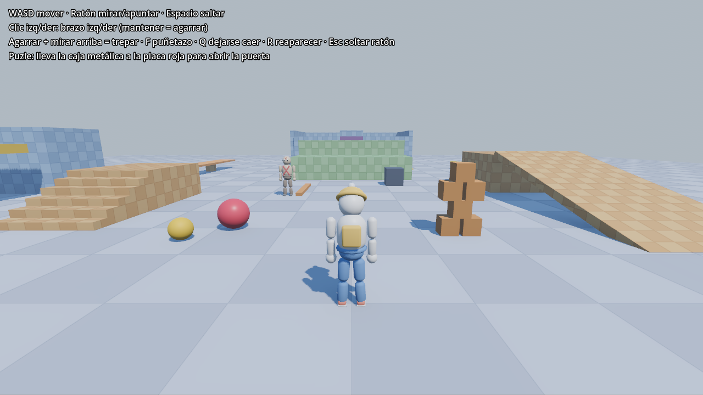

# Ragdoll Puzzle

Prototipo de **controlador de personaje ragdoll activo** para un juego de puzles físicos,
inspirado en el *feeling* de Human Fall Flat y Gang Beasts. Hecho en **Godot 4.7** (GDScript, Jolt Physics)
con personajes modelados por script en **Blender**.



## Cómo ejecutar

1. Abre la carpeta con Godot 4.7+ (estándar o .NET).
2. Pulsa **F5**: la escena principal es `scenes/levels/test_arena.tscn`.

## Controles

| Acción | Teclado/ratón | Mando |
|---|---|---|
| Moverse | WASD / flechas | Stick izq. |
| Mirar / apuntar brazos | Ratón | Stick der. |
| Saltar | Espacio | A |
| Brazo izq. / der. (mantener = agarrar) | Clic izq. / der. | LT / RT |
| Trepar | Apunta al borde y agarra, luego mira arriba + W; suelta al estar arriba | |
| Puñetazo | F | X |
| Dejarse caer (flácido) | Q | B |
| Reaparecer | R | Back |
| Soltar el ratón | Esc | |

## Cómo funciona el ragdoll (`scripts/ragdoll/ragdoll_character.gd`)

- **Cuerpo 100% físico**: 11 `RigidBody3D` (pelvis, torso, cabeza, brazos, antebrazos, muslos, espinillas)
  unidos con `ConeTwistJoint3D`. No hay `AnimationPlayer` ni `CharacterBody3D`.
- **Músculos PD**: cada parte recibe un torque proporcional-derivativo hacia una pose objetivo relativa a su
  padre (con el torque opuesto aplicado al padre, acción-reacción). Se escala con el tensor de inercia real.
- **Equilibrio**: torso y pelvis tienen un "músculo de equilibrio" que los mantiene verticales y orientados
  hacia donde mira la cámara, y un muelle vertical sostiene la pelvis a `stand_height` cuando hay suelo.
- **Caminar**: fuerza horizontal en pelvis/torso hacia la velocidad deseada + ciclo de pasos procedural
  (seno) en las piernas y balanceo de brazos.
- **Brazos independientes (HFF)**: cada botón levanta un brazo hacia la dirección de la cámara; si la mano toca
  un cuerpo se crea un `Generic6DOFJoint3D` (rótula) entre la mano y el objeto. La mano solo se cierra cuando el
  brazo ya apunta hacia la mira (así no se agarra a media pared mientras sube), y una compensación de gravedad
  evita que los brazos extendidos se cuelguen.
- **Trepar**: agarrado a algo fijo (o muy pesado) y mirando arriba, los brazos izan el cuerpo; empujando hacia
  delante el torso se dobla sobre el borde y la cadera pasa por encima. Ajustable con `climb_strength`,
  `climb_min_pitch`, `climb_min_anchor_mass`.
- **Estabilidad**: toda amortiguación muscular se limita para no frenar más del 70 % del giro en un paso de
  física (35 % sobre el cuerpo padre). Sin ese límite, piezas de poca inercia (giro vertical de pelvis/torso)
  temblaban a 15–20 rad/s.
- **Combate (Gang Beasts)**: puñetazo con impulso; un golpe fuerte en la cabeza (`knockout_speed`) deja KO
  durante `knockout_duration`: fuerza muscular = 0 → ragdoll flácido, y luego se levanta solo.
- **NPC**: el mismo script con `player_controlled = false`. Con `ai_target_path` persigue y golpea al objetivo.

Todos los parámetros (rigidez, velocidad, salto, KO…) están expuestos en el inspector.

## Escenario de pruebas (`scenes/levels/test_arena.tscn`)

- Rampa, escaleras y torre con **ascensor** (movimiento y pendientes).
- **Muro escalable** de 1,5 m y 2,6 m (agarrar + trepar).
- **Puzle**: lleva la caja metálica (15 kg) a la placa de presión → se abre la puerta → entra en la zona verde.
- **Balancín** con `HingeJoint3D`, **aspa giratoria** que derriba, torre de cajas, pelotas y tablón.
- **Muñeco quieto** para empujar/agarrar y **ring de sparring** con un muñeco que te persigue y golpea.

## Personajes (Blender)

`art_source/build_characters.py` genera los personajes con la API de Blender y los exporta a
`assets/characters/*.glb`. Cada parte del cuerpo es un objeto separado cuyo origen coincide con el centro del
cuerpo rígido en Godot (las dimensiones deben coincidir con `PARTS` en `ragdoll_character.gd`).

```bash
blender -b --factory-startup --python art_source/build_characters.py
```

- **Nocto** (jugador): personaje gominola con gorro de lana y mochila.
- **Dummy** (NPC): muñeco de entrenamiento con correas cruzadas.

Los `.blend` resultantes quedan en `art_source/` (con `.gdignore` para que Godot no los importe).

## Pruebas automáticas

- `tests/test_ragdoll.tscn`: estar de pie, caminar, saltar, KO + recuperación, levantar brazos (alineación
  promedio con la mira), agarrar y
  arrastrar la caja, y soltar.
- `tests/test_climb.tscn`: apuntar al borde de la repisa de 1,5 m, agarrarlo, mirar arriba, izarse, pasar el
  borde y quedar de pie arriba.

```bash
godot --headless res://tests/test_ragdoll.tscn
godot --headless res://tests/test_climb.tscn
```

Imprime líneas `ASSERT ok|fail <nombre>`.
